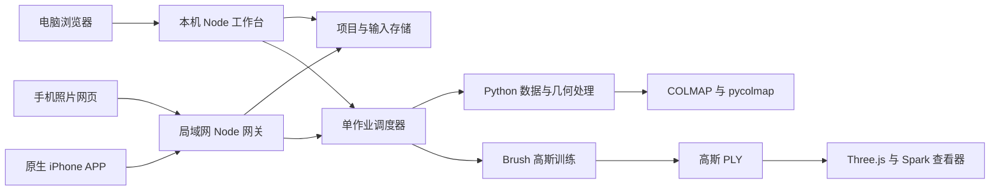
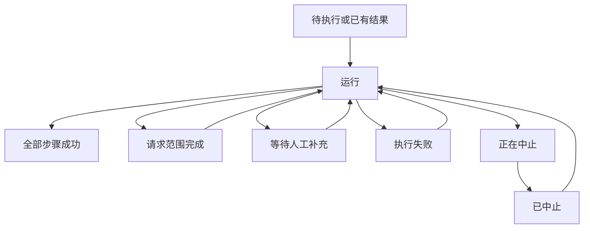

# GaussRoom 代码设计

本文档描述当前实现，包含本轮手机网页自动采集。核对日期为 2026-11-04。它是接口、状态和扫描格式的主要参考。操作流程见 [README](../README.md)，算法导读见[技术讲解](TECHNICAL_GUIDE.md)。

## 1. 系统结构与职责



### 1.1 服务端模块

- [server.mjs](../tools/workbench/server.mjs)：桌面路由、摘要、文件读取、手机连接管理和服务生命周期。
- [paths.mjs](../tools/workbench/lib/paths.mjs)：仓库路径、环境变量、外部工具和 Python 依赖探测。
- [http.mjs](../tools/workbench/lib/http.mjs)：路由、JSON、静态文件和流式文件响应。
- [projects.mjs](../tools/workbench/lib/projects.mjs)：项目创建、更新、摘要、启动对账、区域复制、导出选择与删除。
- [pipeline.mjs](../tools/workbench/lib/pipeline.mjs)：七阶段定义、命令、超时、进度解析、几何门禁常量和训练数据检查。
- [jobs.mjs](../tools/workbench/lib/jobs.mjs)：唯一计算槽、子进程、取消、日志、状态事件和阶段执行。
- [artifact-paths.mjs](../tools/workbench/lib/artifact-paths.mjs) 与 [attempts.mjs](../tools/workbench/lib/attempts.mjs)：尝试目录、输入快照、历史列表与验证后采用。
- [assistance.mjs](../tools/workbench/lib/assistance.mjs)：辅助记录、修订、文件锁、输入校验。
- [assistance-diagnosis.mjs](../tools/workbench/lib/assistance-diagnosis.mjs)、[assistance-service.mjs](../tools/workbench/lib/assistance-service.mjs) 和 [assistance-import.mjs](../tools/workbench/lib/assistance-import.mjs)：问题诊断、几何输入快照、求解编排、照片导入与资料复用。
- [quality.mjs](../tools/workbench/lib/quality.mjs)：质量状态、画面检查及评估图身份绑定。
- [timing.mjs](../tools/workbench/lib/timing.mjs)：阶段与项目累计执行时间。
- [mobile.mjs](../tools/workbench/lib/mobile.mjs)：独立网关、配对、设备授权、扫描包续传和导入。
- [photo-sessions.mjs](../tools/workbench/lib/photo-sessions.mjs) 与 [photo-validator.mjs](../tools/workbench/lib/photo-validator.mjs)：照片批次、逐文件上传、校验、提交恢复和删除恢复。

Node 服务使用内置模块，不依赖 npm 服务框架。业务状态主要保存在 JSON 和文件目录中；COLMAP 使用 SQLite 匹配数据库。系统没有独立数据库服务。

### 1.2 Python 与外部程序

[py](../tools/workbench/py) 中的 `prepare_project.py` 生成工作照片与清单；`sparse_reconstruct.py` 包装普通照片的稀疏重建；`gate_model.py` 检查最终几何。`scan_archive.py` 校验扫描包；`arkit_reconstruct.py` 安装标定并按已知位姿三角化。

人工辅助按职责分成输入、特征、数据库、初始化、对齐、几何与局部修正模块。主要入口为 [assisted_reconstruct.py](../tools/workbench/py/assisted_reconstruct.py) 和 [assisted_local_job.py](../tools/workbench/py/assisted_local_job.py)。

COLMAP 命令行程序负责特征与匹配，以及普通照片位姿恢复。pycolmap 负责模型访问、三角化与几何优化。Brush 是独立训练进程，工作台不在 Node 中实现训练器。

### 1.3 客户端

[public](../tools/workbench/public) 中的 `app.js` 管理桌面项目和作业。`assistance.js`、`annotation.js` 和 `quality-review.js` 分别处理辅助流程、像素标记与画面检查。`viewer.html` 使用仓库内的 Three.js 与 Spark 模块加载 PLY。

[public/mobile](../tools/workbench/public/mobile) 是原生 HTML、CSS 和 JavaScript 手机页面。`state.mjs` 提供提交条件、分页和状态计算。`capture.mjs` 处理画质检查、定时循环、IndexedDB 与串行恢复上传。`capture-map.mjs` 按版本显示相机和稀疏点。浏览器保存配对信息、批次及待选文件摘要；页面内采集另保存待传 Blob。服务器保存已上传文件。

[apps/ios/GaussRoom](../apps/ios/GaussRoom) 使用 SwiftUI 组织页面，RealityKit 显示采集网格，SceneKit 显示离线模型，WKWebView 显示在线高斯场景。`ScanCapture.swift` 采集，`Core.swift` 提供几何与编辑结构，`OBJExporter.swift` 生成纹理模型，`ScanArchive.swift` 打包，`MobileClient.swift` 连接电脑。

## 2. 数据与存储

### 2.1 项目记录

`project.json` 的主要字段为：

- 身份：`id`、`name`、`createdAt`、`updatedAt`。
- 输入：`sourceDir`、`sourceImageCount`、可选 `photoSources`、`inputKind` 和 `capture`。
- 配置：`trainingPreset`、`useGpu`、`cameraModel`、`mapper`、`featurePreset`。
- 执行：`state`、`steps`、`currentStep`、`lastError`。
- 模型：`selectedModel`、`activeAttemptId`、`pendingAttemptId`、可选 `componentSource` 和 `trainingResume`。
- 手机照片关联：可选 `photoSessionId`。

`inputKind` 为 `photos` 或 `arkit_scan`。旧项目缺少该字段时按 `photos` 处理。LiDAR 的 `capture` 保存 `{format,scanId,root,manifestSha256}`；`root` 是电脑内部路径，不返回给手机。

桌面项目摘要由 `summarise` 派生。它增加进度、质量、时间和场景入口。手机使用删减后的摘要，不直接返回 `project.json`。

### 2.2 目录布局

下列目录是逻辑结构，不表示每个项目均已生成全部产物：

```text
projects/
  <project-id>/
    project.json
    assistance.json                 # 可选，跨尝试的用户资料
    source-images/                  # 手机照片或明确追加的输入副本
    capture/                        # LiDAR 原始包解开后的数据
    attempts/
      a-<24位十六进制>/
        attempt.json
        inputs/
          source-project.json
          images/
          matching.db               # 按流程产生的冻结匹配输入
          models/                   # 可选的来源模型快照
        manifest.json               # 工作图片清单
        contact-sheets/
        sfm/
          database.db
          database-incremental.db   # 普通增量式重建副本
          database-global.db        # 普通全局式校准副本
          sparse/0/
        summary/
          gate.json
        undistorted/
          images/
          sparse/
          geometry-source.json
        train/
          export_<step>.ply
          eval_<step>/
        logs/<step-id>.log
  .mobile/
    state.json
    certificates/current.json       # 私有 CA 与服务器密钥包；不提供下载
    uploads/<upload-id>.json
    uploads/<upload-id>.part
    photos/<session-id>/
      session.json
      <file-id>.part
      ready/<file-id>.<extension>
      thumbnails/<file-id>.jpg
      analysis/
        status.json                 # 独立分析状态；不属于重建尝试
        map.json                    # 最近成功的位置图
        inputs/                     # 私有输入快照
        work/                       # 工作图、特征数据库、匹配缓存及模型
```

早期项目直接把 `images`、`sfm`、`summary`、`undistorted`、`train` 和 `logs` 放在项目根目录。`artifactDirs` 根据尝试 ID 选择旧布局或新布局。不要把项目根目录等同于当前工作目录。

手机照片成功提交后，`ready` 中的有效输入复制到项目 `source-images`，随后清理暂存副本。完整扫描放在 `capture` 中。手机网格裁剪不改变 `capture` 中用于电脑重建的原始输入。

### 2.3 三类清单和文件身份

- 扫描清单 `capture/manifest.json`：描述传感器原始数据和逐文件哈希，格式为 `gaussroom_scan_v1`。
- 预处理清单 `<workspace>/manifest.json`：描述 `records[].source`、`sha256`、`work_image`、`work_size`、排除原因及相机组。
- 尝试记录 `attempt.json`：描述计算类型、输入修订、输入指纹、结果与失败原因。

这三者用途不同。扫描关键帧编号、工作图片名、COLMAP `image_id` 和 `camera_id` 也不同。通过清单与数据库名称显式关联，不能按目录顺序或从 1 连续编号推断。

## 3. 状态、调度与恢复

### 3.1 项目与阶段

项目状态包括 `idle`、`running`、`aborting`、`aborted`、`partial`、`needs_input`、`failed` 和 `done`。`partial` 表示本次请求范围结束，但七阶段尚未全部成功；不是训练质量等级。

阶段状态包括 `pending`、`running`、`success`、`failed`、`aborted`、`needs_input` 和 `blocked`。`blocked` 表示前置条件阻止后续阶段运行。



`jobs` 的内存 `active` 集合是单作业锁。已有作业时新启动返回 409，不持久化等待队列。日志写入文件，实时进度主要保存在活动项目对象中，状态边界再持久化。桌面 SSE 先发送快照，再推送变化。手机轮询摘要。

每阶段设有执行上限：预处理 15 分钟、特征 30 分钟、匹配 120 分钟、稀疏 60 分钟、门禁 2 分钟、去畸变 30 分钟、训练 180 分钟。超时是保护上限，不是预期性能。

服务启动检查遗留子进程和未闭合作业。它只处理可核对归属的进程，随后对账项目记录。运行中断不会自动重启 COLMAP 或 Brush。用户查看日志后决定重试。

### 3.2 人工辅助与尝试

辅助记录 `version:1`，`revision` 单调增加。常见状态为 `needs_input`、`ready`、`solving`、`verified`、`failed` 和 `stale`。保存使用文件锁与修订检查，防止旧页面覆盖新输入。

可编辑资料包括 `answers`、`regionLabels`、`objects`、`landmarks`、`dimensions`、`coverage`、`onlyExistingPhotos` 和 `localRepair`。坐标属于已统一方向的工作图片像素。客户端只可提交 `origin:"manual"`；检测结果由计算流程产生。

`localRepair` 分开记录修正照片、固定参照和背景照片；集合不能交叉。它还可指定角点细化和排除区域。尺寸来源区分实测、估计和未知；估计尺寸不能自动证明实际尺度。

尝试类型为 `automatic` 或 `assisted`，状态包括 `created`、`verified`、`needs_input`、`stale`、`failed` 和 `aborted`。采用前核对回答修订、照片、匹配内容、几何及配置指纹，以及最终几何签名。只有验证结果才可更新 `activeAttemptId`。`pendingAttemptId` 可保存待补充或尚未采用的尝试。

### 3.3 手机批次与文件

批次按 `open → committing → committed` 提交。中断时按持久化状态恢复。删除使用 `deleting` 状态；清理完成后移除记录。启动不会自动重授予处于 `deleting` 的项目。

文件按 `pending → uploading → ready` 上传。重复内容变为 `duplicate`，异常变为 `failed`。重试允许 `pending` 或 `failed`。服务重启把残留 `uploading` 改为失败，清理部分文件，让用户重新上传当前照片。

提交前检查全部条目，不能只看当前分页。有效计数仅统计 `ready`。删除有效原件后，依赖它的重复条目改为失败，避免重复条目冒充完整输入。

### 3.4 累计时间与质量

阶段持久化时间为 `{elapsedMs,runningSince,complete}`。开始执行时保留既有累计值；结束时结算。摘要返回 `{elapsedMs,complete,running,asOf}`。项目时间是已知阶段时间之和。旧时间戳只能证明最近一次执行，历史不完整时 `complete:false`。

`quality` 独立返回 `geometry`、`coverage`、`appearance`、`scale`、`trainingComplete` 和 `complete`。几何签名过期会撤销对应验证。画面检查必须绑定当前尝试和模型签名。当前汇总完成要求几何、覆盖、画面和目标训练完成；尺度状态另行显示。

LiDAR 摘要的 `scaleSource:"lidar"` 表示坐标来源。它不同于质量字段中的 `scale:"calibrated"`。深度报告明确设置 `scaleMeasured:false`。

## 4. 重建执行契约

七阶段及命令统一由 [pipeline.mjs](../tools/workbench/lib/pipeline.mjs) 定义：

1. `prepare`：复制、方向统一、去重、长边缩到最多 2,048 像素，排除低于 1,000 像素的输入，记录清单与相机分组。
2. `features`：普通照片按相机组提取 SIFT；LiDAR 为每张图片创建独立相机，再写入缩放后的实际 `PINHOLE` 内参。
3. `match`：使用 COLMAP 穷举匹配；增强档开启引导匹配。
4. `sparse`：普通照片选择增量或全局重建；LiDAR 固定位姿与内参，仅三角化和优化真实观察对应的三维点。
5. `gate`：检查注册率、误差、稀疏点和真实观察连通性；门禁选择合格模型。
6. `undistort`：对已验证模型去畸变，并记录数据来源签名。
7. `train`：检查数据和恢复条件后调用 Brush，验证目标步数导出。

普通全局式流程先复制 SQLite 数据库，再运行 `view_graph_calibrator` 和 `global_mapper`。校准失败不启动全局定位。增量式也使用数据库副本，保留原匹配输入。

门禁常量是注册率 `0.80`、误差 `2.0` 像素、点数 `5000`、碎片份额 `0.05`。最终是否合格还取决于模型内观察轨迹连通性。仅存在一个稀疏目录不足以证明连通。

训练档位的步数、高斯上限、SH 阶数和导出间隔见 [README](../README.md)。训练命令固定随机种子并保存评估图。进度使用阶段权重与日志解析；百分比不表示剩余时间的精确预测。

去畸变目录的 `geometry-source.json` 绑定模型、尝试、几何签名和数据签名。`trainingResume` 还绑定档位、恢复步数及 `init.ply` 的 SHA256。更晚模型或评估图存在时，旧恢复点被拒绝。重新去畸变会清除旧恢复配置。

`resumeCheckpoint` 是桌面运行请求允许的字段，但当前恢复校验以项目已有的 `trainingResume` 和检查点为准。它不是任意文件路径导入接口，不能仅传此字段就完成恢复准备。

<a id="http-api"></a>
## 5. HTTP 接口总则

### 5.1 监听和权限

桌面默认 `http://127.0.0.1:8123`；端口来自环境、命令行或默认值，冲突时顺延。桌面 API 没有账号系统，仅供本机使用。手机连接管理接口另检查 Host、Origin 和跨站请求标记。

手机网关默认关闭。HTTP 启用后监听 `0.0.0.0:8124`；HTTPS 启用后另监听 `0.0.0.0:8125`。它只接收实现中允许的私有网络来源。网关不代理全部桌面路由，不提供任意本机文件访问。HTTP 没有传输加密，连续采集使用可信 HTTPS。

手机除配对和公开页面资源外需要 `Authorization: Bearer <device-token>`。令牌在电脑按 SHA256 保存。`POST /api/mobile/v1/session` 可为查看器设置 HttpOnly、SameSite=Strict Cookie；Cookie 仅授权 GET/HEAD，写操作仍须 Bearer。令牌不放在 URL。

### 5.2 编码、响应与错误

JSON 请求使用 `Content-Type: application/json`。通用 JSON 请求上限为 1 MiB。二进制上传按专用路由处理，不使用 JSON 编码。文件读取支持相应的 HEAD 行为。

多数错误为 `{"error":"原因"}`，桌面部分错误附加 `details`。主要状态码：400 参数或格式错误；401 手机未配对或已撤销；403 网络、来源或配对码不允许；404 资源不存在或对当前设备不可见；409 状态、修订、偏移或前置检查冲突；413 容量超限；429 配对限流；503 状态保存或校验器不可用；500 未分类内部错误。

手机未知内部异常只返回“网关内部错误”，避免暴露主机路径。下面按业务分组列出接口；没有列出的任意磁盘读写不是公共能力。

## 6. 桌面 API

### 6.1 环境和项目

- `GET /api/health`：返回工具、依赖、路径、磁盘空间和忙碌项目。仅本机接口允许返回环境路径。
- `GET /api/presets`：返回训练档位、特征档位和门禁常量。
- `POST /api/dialog/folder`：请求 `{title?}`；打开 Windows 文件夹选择器。选中返回 `{path,imageCount}`，取消返回 204。
- `GET /api/projects`：返回项目摘要数组。
- `POST /api/projects`：请求 `{name,sourceDir,trainingPreset,useGpu?,cameraModel?,mapper?,featurePreset?}`；201 返回项目摘要。`trainingPreset` 必填。
- `GET /api/projects/:id`：返回当前项目摘要，叠加运行中内存进度。
- `PATCH /api/projects/:id`：支持名称、训练档位、GPU、相机模型、特征档位、mapper 和已存在的 `selectedModel`。运行中关键设置返回 409。响应为摘要。
- `DELETE /api/projects/:id`：非运行项目删除成功返回 `{removed:id}`；删除路径按已验证请求 ID 解析。
- `POST /api/projects/:id/components`：请求 `{model,component}`。全局空闲时创建独立区域项目，自动运行至几何门禁，201 返回新项目摘要。

示例创建请求：

```json
{
  "name": "示例双房间",
  "sourceDir": "D:/RoomPhotos/demo",
  "trainingPreset": "standard",
  "useGpu": true,
  "cameraModel": "SIMPLE_RADIAL",
  "mapper": "incremental",
  "featurePreset": "standard"
}
```

路径为占位示例；调用前准备实际目录。合法相机模型为 `SIMPLE_RADIAL`、`OPENCV`、`RADIAL`、`PINHOLE`。合法 mapper 为 `incremental`、`global`。

### 6.2 执行、日志和成果

- `POST /api/projects/:id/run`：请求可含 `{fromStep,untilStep,trainingPreset,allowTrainClean,resumeCheckpoint}`；202 返回 `{jobId}`。步骤名来自七阶段 ID。调用不能绕过几何、覆盖或训练数据检查。
- `POST /api/projects/:id/abort`：中止当前作业，202 返回 `{aborted:true}`。没有活动作业时返回 409。
- `GET /api/projects/:id/events`：SSE 事件为 `state`、`log`、`progress`；先推送快照与日志尾部，并每 15 秒发送保活注释。
- `GET /api/projects/:id/log?step=<id>&tail=<bytes>`：返回日志文本。默认尾部 65,536 字节，限制在 1 KiB 至 4 MiB。
- `GET /api/projects/:id/summary`：返回当前与待处理门禁、模型摘要、精简图片清单、辅助记录、质量和尝试列表。
- `GET /api/projects/:id/scene`：返回最新导出元数据及相对文件 URL；没有成果时返回 `null`。
- `GET /api/projects/:id/scene.ply?download=1`：流式读取当前导出，可选下载响应。
- `GET /api/projects/:id/attempts/:attemptId/scene` 和同路径 `scene.ply`：读取历史尝试成果；`attemptId=legacy` 表示旧布局。
- `GET /api/projects/:id/image`：按 `photoId` 或 `name` 读取工作图片，可选 `attemptId`。路径必须位于解析后的工作图片目录。
- `GET /api/projects/:id/evaluation?attemptId=<id>`：返回固定评估照片集合与可用步数。
- `GET /api/projects/:id/evaluation/image?step=<n>&name=<file>&attemptId=<id>`：只读取评估清单中存在的图片。

`scene` 元数据可能包含电脑内部路径，因此它属于桌面契约。手机使用下一节的删减响应，不调用这些桌面资源接口。

### 6.3 人工辅助

辅助几何求解、局部位置修正和追加普通照片仅适用于 `photos`。`arkit_scan` 对相应操作返回 409，位置或连接有误时需要重新扫描并导入新包。仅确认覆盖的分支可以重新运行门禁，不改变采集位姿。读取诊断资料不等于允许重新估计 LiDAR 相机。

接口前缀为 `/api/projects/:id/assistance`：

- `GET`：返回 `{record,quality,catalog,attempts}`。
- `PUT`：请求 `{expectedRevision,patch}`，保存并返回 `{record,quality}`。
- `POST /check`：请求 `{expectedRevision}`，在空闲时重新诊断并进入补充状态。
- `POST /run`：请求 `{expectedRevision,untilStep?}`；`untilStep` 只允许 `gate` 或 `train`。202 返回 `{project,attemptId,jobId}`。准备尚未结束时 `attemptId` 可为 `null`。
- `POST /review`：请求 `{expectedRevision,attemptId,geometrySignature,review}`；记录与当前模型绑定的画面检查。
- `GET /reuse?sourceProjectId=<id>`：预览可复用资料。
- `POST /reuse`：请求 `{expectedRevision,sourceProjectId,answerIds}`，仅复用用户选择的资料。
- `POST /photos`：请求 `{expectedRevision,sourceDir}`，复制追加照片并更新输入；不自动启动计算。

`patch` 是可编辑资料的完整集合语义：未提供的集合按空值处理。客户端应读取记录、保留未修改资料，再提交完整编辑值。不能把它当作只发送单个字段的无损增量合并。

对应点格式为 `{id,objectId,observations:[{photoId,xy:[x,y],origin:"manual"}]}`。共同物体可使用 `kind:"planar"` 的同序四角或 `kind:"points"` 的离散对应点。`dimensions` 使用 `mm|cm|m`，来源为 `measured|estimated|unknown`。`coverage` 判断为 `existing|new|unknown`。

`review` 包含 `appearance:"passed"|"needs_improvement"`、`requestPositionCheck` 和 `items`。检查项代码为 `doorway`、`ghosting`、`proportions`、`coverage`、`other`。标记通过前，前四类均须通过，且不能同时请求位置复查。

### 6.4 手机连接管理

以下接口只供本机工作台调用：

- `GET /api/mobile/status`：返回启用状态、端口、局域网地址、有效配对码、过期时间和设备列表。
- `POST /api/mobile/enable`：启动网关并生成配对码；已启用时直接返回当前状态。
- `POST /api/mobile/https/enable`：需要时启动 HTTP，再签发或更新证书并监听 HTTPS。返回扩展状态 `httpsEnabled`、`httpsPort`、`certificate`、`httpsError`。证书准备失败返回 503；HTTP 入口仍可使用。
- `POST /api/mobile/disable`：关闭网关。
- `POST /api/mobile/revoke`：请求 `{deviceId}`，撤销设备令牌。
- `POST /api/mobile/import`：请求 `{path}`，从本机 `.gaussroom.zip` 导入；返回 `{projectId}`。

## 7. 手机网关 API

### 7.1 配对、能力与项目

前缀为 `/api/mobile/v1`：

- `POST /pair`：请求 `{code,deviceName}`，返回 `{token,deviceId}`。名称最多 100 字符；配对码有效期 5 分钟，成功后消费。每来源每分钟最多接纳 8 次配对尝试。需要新码时在电脑关闭再启用连接。
- `POST /session`：Bearer 验证后建立只读 Cookie，返回 `{ok:true}`。
- `GET /capabilities`：返回 `photoFormats`、`limits`、`trainingPresets` 和当前 `deviceId`，手机以此配置选图入口、限制和本地采集归属。
- `GET /projects/:id`：返回删减摘要 `{id,name,state,steps,progress,timing,quality,lastError,scene}`。错误详情由电脑日志查看，响应不含主机路径。
- `POST /projects/:id/run`：请求仅含 `{trainingPreset:"standard"}` 等有效档位。202 返回 `{jobId}`；忙碌或前置检查冲突返回 409。
- `GET /projects/:id/scene.ply`：读取已授权项目的当前高斯导出，没有导出时返回 404。

`scene` 为 `null` 或 `{viewerUrl}`。查看 URL 指向共享 `/viewer.html`，参数包含授权场景地址，以及可用的 home、basis、radius。查看器及其本地模块使用只读资源白名单。网关不能读取任意桌面项目或任意静态路径。

<a id="photo-api"></a>
### 7.2 普通照片批次

前缀为 `/api/mobile/v1/photo-sessions`。成功业务响应均为 200：

- `POST`：请求 `{name,trainingPreset?}`，返回新批次 DTO。名称最多 200 字符，档位默认 `standard`。
- `GET`：返回当前设备的批次 DTO 数组。
- `GET /:id`：返回一个批次 DTO。
- `POST /:id/files`：请求 `{name,bytes,clientCaptureId?}`，预留条目，返回 `{fileId,session}`。名称最多 255 字符；采集 ID 必须为 UUID。同一批次重复 ID 且名称、长度相同，返回原条目；参数冲突返回 409。幂等查询先于容量预留检查。
- `PUT /:id/files/:fileId`：发送该文件的完整原始二进制内容；长度须等于预留值。成功返回批次 DTO。
- `DELETE /:id/files/:fileId`：仅开放批次可移除条目，返回更新后的批次 DTO。
- `POST /:id/commit`：校验所有有效文件并创建项目，返回 `{projectId}`。重复提交返回同一 ID。
- `DELETE /:id`：删除批次及其关联普通照片项目，返回 `{removed:<sessionId>,projectId}`。资源已删除后再次请求可返回 404，前端按已不存在处理。

DTO 包含 `id`、`name`、`trainingPreset`、`status`、`projectId`、`files`、`uniqueCount` 和 `totalBytes`。文件条目包含 `id`、`name`、`bytes`、`status`、`error`、`sha256`、`width`、`height`、`duplicateOf` 和可选 `clientCaptureId`。

默认限制：`maxFileBytes=67108864`、`maxFiles=500`、`maxBatchBytes=4294967296`、`minLongEdge=1000`。图片校验还限制像素数不超过 100,000,000。扩展名与实际编码必须匹配；`.jpeg` 保存时规范为 `.jpg`。HEIC/HEIF 通过已配置 ffmpeg 和真实夹具探测后开放，探测结果缓存 60 秒。

提交要求至少两项 `ready`，且不存在 `pending`、`uploading` 或 `failed`。`duplicate` 不增加有效张数。服务器逐文件复算 SHA256 后才进入 `committing`。创建项目前先保存恢复记录，成功后复制输入、写项目关联、标为 `committed` 并授予设备访问。

同一批次的修改使用独占锁。上传流、解码校验和其他异步步骤完成后重新检查授权。服务重启恢复成功批次时，仅向仍有效的设备授予关联项目。

删除前检查有效所有者、UUID 路径、照片批次与项目的实际关联，以及活动作业。关联 LiDAR 项目或无关项目时拒绝。清理前写入 `deleting`，保留元数据直到数据删除完成。即使项目元数据已删而输出目录仍残留，重试仍会清理。失败返回 503，不暴露电脑路径。

<a id="capture-api"></a>
### 7.3 自动采集与位置分析

`getUserMedia` 请求后置相机，理想宽高为 1920×1080。实际尺寸来自 `videoWidth`、`videoHeight`。Canvas 使用完整尺寸，不按取景框裁切；JPEG 质量参数为 0.94。长边不足 1,000 像素时拒绝自动模式。定时器在上一轮完成后重新排程，不并发拍摄，也不补发错过的快门。间隔为 1、1.5、2 秒，默认 1.5 秒。

低分辨率画面计算亮度、明暗像素比例、灰度方差、拉普拉斯方差、dHash 与灰度差。阈值只用于明显异常及高度相似的有纹理画面。弱纹理不证明重复位置。手动补拍绕过相似检查，保留其他检查。算法没有手机实时空间位姿，不声称识别全部重复物理位置。

IndexedDB 数据库 `gaussroom-captures` 保存采集 UUID、设备、批次、名称、字节数、时间与 Blob。写事务同时检查 20 张和 128 MiB 上限。Blob 持久化成功后才登记和上传。恢复时先按 `clientCaptureId` 查询服务器；已为 `ready` 或 `duplicate` 时释放 Blob，否则复用原文件 ID 重传。401 立即停止相机和上传，保留 Blob。新的设备只能显式把本地照片分配给自己的新批次，不能获得旧设备的服务器数据。HTTP 与 HTTPS 的 IndexedDB、localStorage 不共享。

接口前缀为 `/api/mobile/v1/photo-sessions/:id`。所有接口须通过当前设备授权及批次归属检查：

- `POST /capture-analysis`：请求 `{action:"start",force?:boolean}`，202 返回分析状态。首轮至少 20 项有效照片；之后默认至少新增 12 项且间隔不少于 15 秒。`force` 只放宽后续新增张数，不放宽首轮或时间限制。运行中以最新请求合并待处理快照。`{action:"cancel"}` 等待退出，200 返回状态；仅开放批次可开始分析，已提交批次仍可停止分析。
- `GET /capture-analysis`：200 返回 `{status,revision,lastMapRevision,processedCount,requestedCount,updatedAt,error}`。状态为 `idle|waiting|running|ready|failed|cancelled`。`updatedAt` 是 Unix 毫秒；错误不含主机路径。状态读取不申请新的分析。
- `GET /capture-map`：200 返回最近成功地图；尚无地图返回 404。失败或超时不清除上一版有效地图。
- `GET /files/:fileId/thumbnail`：200 返回最长边 256 像素的 JPEG，应用照片方向。只允许有效上传项；提交后从已验证关联项目副本读取。生成完成后再次检查授权、输入版本和文件身份。404 表示照片不可见或尚未就绪，503 表示生成失败。

地图包含 `revision`、`updatedAt`、`scale:"unmeasured"`、`coordinateSystem`、`cameras`、`points`、`unlocalized`、`processedFileIds` 和 `suspectedDuplicates`。坐标约定为 `{up:"y",cameraForward:"-z",matrixOrder:"column-major",units:"arbitrary"}`。每个相机为 `{fileId,cameraToWorld:[16个数],intrinsics:[fx,fy,cx,cy],width,height}`。矩阵把相机局部坐标变到地图世界坐标；相机局部右为 +X、上为 +Y、前为 -Z。内参对应分析工作图像素。点为 `{position:[x,y,z],color:[r,g,b]}`，颜色为 0～255。未定位列表使用服务器文件 ID，不补造坐标。

`capture_analysis.py` 先按真实文件 ID 建立工作图片名。工作图长边最多 1600，SIFT 最多 4096 特征。缓存已处理图片、数据库特征及匹配对。每张新图选择前面最多 10 张时序照片，以及更早历史中最多 5 张 dHash 相似照片。COLMAP `matches_importer --match_type pairs` 仍执行真实匹配和几何验证；相似指纹不直接生成三维点。随后运行增量 mapper。只导出最大的真实轨迹连通区域和最多 10,000 个点。COLMAP `image_id` 可以不连续，必须按数据库中的图片名称映射文件 ID。

COLMAP 的相机前为 +Z、下为 +Y。设 `C=diag(1,-1,-1,1)`，其世界到相机矩阵为 `Tcw`，地图使用 `C × inverse(Tcw) × C`，并按列主序展开。三维点使用 `C` 转换。模型单位没有米制标定。相近相机位置及朝向仅产生疑似重复提示，已保存输入不自动删除。

[capture-analysis.mjs](../tools/workbench/lib/capture-analysis.mjs) 管理独立快照、缓存、状态和 120 秒上限。[compute-slot.mjs](../tools/workbench/lib/compute-slot.mjs) 在位置分析和正式重建之间提供单个计算租约。正式作业仍在 `jobs.mjs` 管理；分析不写项目步骤、尝试、质量或重建计时。等待期间轮询计算槽，正式重建不自动排队。

每轮固定输入范围。追加输入不使该轮失效，可先发布已处理子集。删除输入、撤销、删除批次及提交会增加输入代次并取消任务；等待进程退出后才继续操作。发布前检查设备、批次开放状态和代次，拒绝旧结果。删除输入同时清除分析缓存与旧地图。服务重启将持久化的运行或等待状态标为中断，保留已有有效地图；后续由用户重试。Windows 分析进程另使用带关闭即终止标志的 Job Object，并持有服务器进程句柄。服务器异常退出时，分析及其原生子进程一并结束，避免遗留计算占用。

地图客户端每版整图替换并重新取景，释放旧几何与材质。相机点击后仅请求对应缩略图。未定位列表单列，并说明地图不是表面覆盖证明。正式重建重新使用普通照片流程，不读取这些预览位姿作为固定标定。

<a id="direction-guidance"></a>
#### 相机方向点与补拍提示

[direction-guide.mjs](../tools/workbench/public/mobile/direction-guide.mjs) 计算方向与当前站位记录。[capture-guidance.mjs](../tools/workbench/public/mobile/capture-guidance.mjs) 管理方向权限、监听器、SVG 点阵和文字提示。模块在浏览器本地运行，不调用位置分析，不增加上传字段，不写训练输入。后置相机使用 `DeviceOrientationEvent`；iOS 的权限请求在按钮点击中、首次异步等待前发起。只请求相对方向，不请求磁北标定。

按照 [W3C Device Orientation](https://www.w3.org/TR/orientation-event/) 的 Z-X-Y 顺序计算旋转矩阵。设备 -Z 为后置镜头朝向，设备 X、Y 定义原始右和上。按屏幕旋转角校正显示右、上，再得到水平朝向和仰角。第一个不接近竖直的有效样本建立本站位参考。方位每 15° 设置一点，共 24 个；仰角为 0°、+35°、-35°，共 72 点。只记录最近的一个方向点；方位偏差最多 8°、仰角偏差最多 10°。样本超过 800 毫秒、不是有限数值、接近竖直或转动速度超过 45°/秒时不记录方向。

SVG 以相机视频实际显示区域为边界，包含横竖屏留边计算。最长画面边的视场近似为 65°，用于绘制方向示意；这不是相机内参标定。点阵不能贴合真实墙面。视野外的目标通过箭头提示方向。模式优先选择未记录点；自动模式先墙面，再上方、下方。门口模式提供共同视角的路线提示，不自动识别门。

采集全尺寸画面前保存方向快照。IndexedDB 写入成功并刷新本地队列后，再按采集 ID 记录方向，避免定时渲染用旧队列删除新记录。引导层独立于视频和照片 Canvas，因此不会进入 JPEG。方向记录仅保存在本次页面内存，并按当前批次的本地待传 ID 与有效服务器 ID 核对；删除项及服务端重复项不继续计数。站位代次防止旧的异步照片点亮新站位。停止、后台或重新启用会建立新的方向参考，不跨会话拼接。已有 Blob、原照片和电脑位置图不受影响。

方向 API 可能不给出数据，也不保证静止时持续发送事件。过旧样本宁可不记录，页面继续显示文字提示，拍照与上传继续运行。已知前置相机不启用方向点。状态与时序检查见 [test_capture_guidance.mjs](../tools/workbench/test_capture_guidance.mjs)；实机清单见 [PRD](PRD.md#verification)。

### 7.4 HTTPS 与身份交接

桌面仍仅监听本机 8123。旧 HTTP 手机网关为 8124，HTTPS 为 8125，两者共享同一授权状态和照片批次。仅私有网络可访问。公开资源为手机页面、`GET /mobile/connection.json`、`GET /mobile/ca.cer` 与 `GET /mobile/ios.mobileconfig`。连接 JSON 只包含 HTTPS 状态、端口及公开证书描述。

[mobile-certificates.ps1](../tools/workbench/scripts/mobile-certificates.ps1) 使用 Windows .NET 原生证书接口，不安装系统信任。CA 有效 5 年；服务器证书有效 90 天，SAN 包含 localhost、127.0.0.1 和当前局域网 IPv4 地址。启用时及之后每分钟检查地址和有效期。剩余不足 14 天或 IP 集合改变时更新服务器证书，并在现有监听器替换 TLS 上下文。有效 CA 保持不变；接近到期时才替换 CA，届时手机需重新信任。

私有包只写入 `certificates/current.json`，目录与文件 ACL 限制当前 Windows 用户和 SYSTEM。先写候选文件，再原子替换。失败保留原文件。`mobile-tls.mjs` 验证签名、SAN、有效期及可加载私钥后才返回。网关仅下载 CA DER 和仅含公开 CA 的 iOS 描述文件，不提供私有包、PFX 或口令。

- `POST /api/mobile/v1/https-handoff`：须 Bearer，接收 `{batchId?}`，校验归属，返回 `{url,expiresIn:60}`。URL 只含随机交接码，目标主机必须为证书覆盖的私有 IPv4 或 localhost。
- `POST /api/mobile/v1/https-handoff/redeem`：仅 HTTPS，接收 `{ticket}`。未配对也可调用，但必须持有有效单次交接码。成功 200 返回 `{token,deviceId,batchId?}`；原设备和令牌保留。过期、重复或非法交接返回 403；设备撤销返回 401。兑换前先消费交接码，不能重复使用。

交接码在内存中按 SHA256 索引，服务关闭即清除。手机在发起网络请求前清除地址片段，再兑换并保存身份。HTTPS 的只读查看器 Cookie 增加 `Secure`。所有写接口继续要求 Bearer；Cookie 不能启动分析、删除、提交或训练。下载后核对 CA 指纹、手机安装和完全信任步骤见 [README](../README.md#启用页面内相机)。

### 7.5 完整扫描包上传

- `POST /api/mobile/v1/uploads`：请求 `{scanId,sha256,bytes}`，返回 `{id,offset,bytes,projectId?}`。`sha256` 是整个 ZIP 的哈希。
- `GET /api/mobile/v1/uploads/:id`：返回当前设备上传的持久化状态。
- `PUT /api/mobile/v1/uploads/:id`：发送不超过 8 MiB 的二进制块，必须带 `Content-Range: bytes start-end/total`。`end` 为包含端点，`start` 必须等于已保存偏移。成功返回 `{offset}`。
- `POST /api/mobile/v1/uploads/:id/commit`：校验完整 ZIP 和包内文件，返回 `{projectId}`。重复提交返回同一项目。同一扫描 ID 对应不同包内容时返回 409。

网络上传 ZIP 最大为 20 GiB。半块请求不前移已保存偏移。下次写入先截断到已确认位置，再写后续块。原生客户端需要重新选择同一文件，并使用电脑确认的偏移恢复。

当前原生选包界面从 `<扫描 UUID>.gaussroom.zip` 文件名取得扫描 ID，并校验本机 `Documents/Scans/<UUID>`。因此须保留原文件名与本地扫描。此约束属于 APP 入口；其他来源的有效扫描包可通过 Windows 离线导入。

扫描导入使用独占导入锁和持久化 `pending` 记录。通过全部校验后生成 `mobile-<UUID>` 项目，移动解包目录到 `capture`，写入标定输入类型。离线导入调用同一校验器。

<a id="scan-format"></a>
## 8. 附录：gaussroom_scan_v1

### 8.1 包结构与版本

扩展名为 `.gaussroom.zip`。ZIP 根目录必须直接包含 `manifest.json`。路径一律为相对 POSIX 路径，使用 `/`。未知 `format` 拒绝导入。

清单字段如下：

- `format`：固定 `gaussroom_scan_v1`。
- `scanId`、`sessionId`：UUID。一次扫描对应同一连续世界坐标会话。
- `createdAt`：ISO 8601 时间。
- `device`：非空字符串 `model` 和 `systemVersion`。
- `coordinateSystem`：下列固定对象。
- `frames`、`mesh`、`edits`：对应 JSON 文件路径；原生导出分别为 `frames.json`、`mesh.json` 和 `edits.json`。
- `files`：除 `manifest.json` 外的每一个普通文件，条目为 `{path,bytes,sha256}`。`bytes` 是非负整数，`sha256` 是 64 位小写十六进制。

```json
{
  "handedness": "right",
  "up": "y",
  "units": "metres",
  "cameraForward": "-z",
  "matrixOrder": "column-major",
  "imageOrientation": "sensor"
}
```

`files` 必须与 ZIP 普通文件集合完全一致，清单自身除外。可省略 ZIP 目录条目。`manifestSha256` 是原始清单字节的哈希，与整个 ZIP 哈希、图片哈希分别使用，不能互换。

### 8.2 关键帧与矩阵

`frames.json` 顶层为 `{"frames":[...]}`。以下是一帧结构示例，不是可直接导入的完整扫描：

```json
{
  "id": "f000001",
  "timestamp": 1.25,
  "image": {"path": "images/f000001.jpg", "width": 1920, "height": 1440},
  "intrinsics": [1000, 0, 0, 0, 1000, 0, 960, 720, 1],
  "cameraToWorld": [1, 0, 0, 0, 0, 1, 0, 0, 0, 0, 1, 0, 0, 0, 0, 1],
  "depth": {"path": "depth/f000001.bin", "width": 256, "height": 192, "format": "float32_le"},
  "confidence": {"path": "confidence/f000001.bin", "width": 256, "height": 192, "format": "uint8"}
}
```

时间、图像、深度、置信度、内参和位姿来自同一 ARFrame。`timestamp` 是会话时间，不是 UTC 拍摄日期。帧 ID 唯一，时间严格递增，三个数据路径不得跨帧复用。完整导入至少两帧，且至少两个 JPEG 内容哈希不同。

图片必须是 `images/<filename>.jpg` 或 `.jpeg`，直接位于 `images` 下。JPEG 尺寸必须等于声明，EXIF orientation 必须为 1。像素保留传感器方向；界面显示旋转不改变存储图像和 K。不得包含未被帧引用的 `images/` 文件。

`intrinsics` 为 3×3 列主序；`cameraToWorld` 为 4×4 列主序。索引规则分别为 `K[row,col]=array[col*3+row]`、`T[row,col]=array[col*4+row]`。上例的内参为 `fx=fy=1000`、`cx=960`、`cy=720`。

矩阵与向量必须有限。K 只允许正焦距、零斜切和标准齐次最后一行。位姿最后一行为 `[0,0,0,1]`，旋转需正交且行列式为 1。图像尺寸为正整数，每个声明图像平面不超过 200,000,000 像素。

### 8.3 深度与置信度

深度为相机轴向深度，单位米，使用小端 float32。按行从上到下紧密排列，无行填充。像素 `(x,y)` 的字节偏移为 `4*(y*width+x)`，文件长度严格等于 `width*height*4`。

置信度为紧密排列的 uint8，取值 `0`、`1` 或 `2`。偏移为 `y*width+x`，文件长度严格等于 `width*height`。它的尺寸必须与深度相同。

深度可能为零或非有限无效值；诊断排除这些值。置信度大于零、深度与投影均有效时才比较误差。RGB 与深度使用相同归一化图像坐标；反投影深度时应把 K 缩放到深度分辨率。

### 8.4 网格与编辑

`mesh.json` 为 `{vertices:[[x,y,z]],normals:[[x,y,z]],faces:[[i,j,k]]}`。顶点和法线在世界坐标中。法线数等于顶点数。面使用从 0 开始的合法整数索引，向量必须有限。

`edits.json` 为 `{crop:null,measurements:[]}`。裁剪可为 `{min:[x,y,z],max:[x,y,z]}`，每个最小值不得大于最大值。测量条目为 `{start:[x,y,z],end:[x,y,z]}`。

编辑只用于手机网格查看和导出副本。电脑从原始图片、标定和匹配观察生成高斯场景，不使用裁剪来删减重建输入。

### 8.5 解包与原始数据验证

校验器拒绝绝对路径、反斜杠、盘符、空段、`.`、`..`、控制字符、Windows 保留名、尾随点或空格，以及忽略大小写后的重名。拒绝符号链接、特殊文件和加密 ZIP。

当前限制为最多 100,000 个 ZIP 条目、解压总量 32 GiB、单文件 4 GiB、清单 16 MiB。每个文件的解压大小还必须不超过 `max(1 MiB,压缩大小×1000)`。这些限制与网络 ZIP 的 20 GiB 上限分别生效。

先检查条目与清单，再流式解压并核对长度和 SHA256，随后检查 JSON、JPEG、矩阵、深度布局、网格和编辑。目标目录必须不存在。失败只清理校验器自己创建的临时目录；成功才重命名发布。

`scan_archive.py --archive <ZIP> --output <NEW_DIRECTORY>` 成功输出 `{scanId,frameCount,imageDirectory,manifestSha256}`。重建前还使用 `verify_scan` 复查原始文件和链接状态。不要把导入成功当作以后可以任意修改原始扫描。

### 8.6 到 COLMAP 的转换

工作分辨率为 `(Ww,Hw)`，原图为 `(Ws,Hs)`，分别令 `sx=Ww/Ws`、`sy=Hw/Hs`。写入参数为 `[sx*fx,sy*fy,sx*cx,sy*cy]`。不要假定两轴缩放因子完全相同。

COLMAP 的世界到相机变换为 `diag(1,-1,-1,1) * inverse(cameraToWorld)`。它改变相机轴约定，不改变 ARKit 世界坐标。位姿与内参保持固定，优化对象是照片匹配产生的三维点。

`arkit_reconstruct.py features` 消费扫描目录、预处理清单、COLMAP、数据库和工作图片；`sparse` 消费同一映射和匹配数据库，输出 `0/` 二进制模型与 `depth-report.json`。数据库实际图片 ID、相机 ID、frame 和 rig 关系均从数据库读取。

深度报告包含比较数量、中位绝对误差米值、`scaleMeasured:false` 和 `purpose:"diagnostic"`。没有有效比较时误差为 `null`。它不能替代几何门禁或实测标定。

## 9. 修改入口与维护规则

- 增加阶段或调整命令：从 pipeline、jobs 和预处理/几何入口开始，检查状态、重试与时间是否同步。
- 修改手机功能：同步网关、照片批次、网页状态模块和原生客户端；保持桌面私有路由隔离。
- 修改几何或局部修正：保留真实观察和来源证明，补充退化场景测试；不能只隐藏质量提示。
- 修改格式：显式升级版本，更新生产端、校验器与转换测试，不能只改清单字段名。
- 修改结果路径：通过 `artifactDirs` 解析，兼容旧项目和历史尝试，不直接拼接当前活动目录。
- 修改质量或画面检查：核对当前尝试、几何签名和评估照片身份，防止旧结论附到新模型。

测试分类和本轮结果见 [PRD](PRD.md#verification)。全量命令见 [README](../README.md)。产品源文件在本轮文档交接中保持不变。
