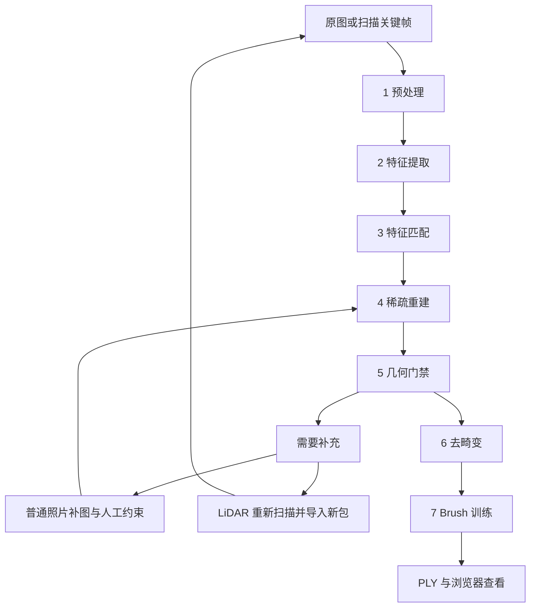
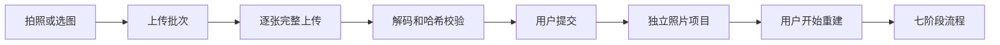
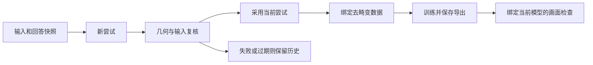

# GaussRoom 技术讲解

本文面向接手项目的开发者。它说明数据如何流动、关键算法解决什么问题，以及出现异常时从哪里查起。实现基准为 `52f94dc`，核对日期为 2026-11-04。完整接口和格式见[代码设计](CODE_DESIGN.md)。

## 1. 先区分三种三维成果

**稀疏模型**保存相机和三维特征点。每个点应能追溯到照片中的实际像素观察。它为相机位置和场景连接提供几何依据，但通常不能直接当作完整房间表面查看。

**网格模型**使用顶点和三角面表示表面。iPhone LiDAR APP 保存 ARKit 网格，并用关键帧为其添加纹理。网格支持离线查看、裁剪和 OBJ 导出。

**高斯场景**使用可渲染的三维高斯表示外观。Brush 根据照片和相机训练这些参数。浏览器读取高斯 PLY，生成新视角画面。高斯场景不是 OBJ 网格，也不直接提供封闭表面或可靠碰撞体。

GaussRoom 的电脑主流程是“照片与相机 → 稀疏模型 → 高斯场景”。原生 APP 还提供一条“传感器网格 → 纹理网格”的离线分支。LiDAR 网格不会直接替代电脑训练需要的照片观察轨迹。

## 2. 贯穿示例与术语

下文使用一个示例：用户拍摄客厅与书房，照片目录为 `D:/RoomPhotos/demo`，项目名为“示例双房间”，训练档位为 `standard`。门口照片包含两个房间都能看到的门框和固定家具。该示例用于说明流程，不代表一次已经完成的实测重建。

常用术语：

- **内参 K**：焦距和主点等相机成像参数，通常以像素为单位。
- **外参或位姿**：相机与世界坐标之间的旋转和平移。
- **特征**：图像中可描述、可匹配的局部位置。
- **观察**：某个三维点在某张照片中的二维坐标。
- **轨迹 track**：同一物理点在多张照片中的观察集合。
- **SfM**：从多张照片恢复相机和稀疏结构的流程。
- **三角化**：根据相机与多幅图像的对应像素估计三维点。
- **束调整 BA**：减小图像观察与模型投影之间误差的联合优化。
- **几何门禁**：决定几何结果是否可以进入后续训练的检查。
- **尝试 attempt**：一次有独立输入快照和输出目录的重建计算。
- **泼溅 splat**：将高斯投影到图像平面并混合成像。
- **球谐 SH**：表示随观察方向变化的颜色的一组基函数。

## 3. 主流程与程序边界



Node 负责操作顺序、文件边界、作业、进度和恢复。Python 负责图像、数据库和几何。COLMAP 提供视觉重建能力，Brush 提供高斯训练能力。浏览器负责操作和显示。

从 [pipeline.mjs](../tools/workbench/lib/pipeline.mjs) 阅读可看到七阶段的命令、输入与验证。再读 [jobs.mjs](../tools/workbench/lib/jobs.mjs)，可理解命令何时运行、何时保存状态，以及何时停止。

一个阶段进程退出成功，只说明它完成了相应命令。阶段还要检查必要输出。整条链路也要检查模型身份和前置质量，不能通过直接调用训练接口跳过检查。

## 4. 预处理：让像素和身份稳定

### 4.1 统一工作图片

示例项目首先读取原图，生成最多长边 2,048 像素的 JPEG 工作副本。普通照片根据 EXIF 统一方向；工作副本保存 orientation 1。低分辨率、无法解码或完全重复的输入记录排除原因。

源文件保持只读。清单记录源路径、原始字节 SHA256、原尺寸、方向统一后的尺寸、工作尺寸和工作图片路径。工作图片还记录自身内容哈希。

这一步解决两个问题。其一，特征和人工标记都使用稳定的像素坐标。其二，后续程序可以证明某张工作图来自哪个原始输入。

代码入口为 [prepare_project.py](../tools/workbench/py/prepare_project.py)。它读取选定目录直接包含的图片，而不是递归扫描所有子目录。HEIC 通过配置的 ffmpeg 解码。

### 4.2 相机分组与内参缩放

普通照片根据设备、镜头、焦距及尺寸证据分组。同组共用一套待估内参。缺少镜头证据时，程序按设备和尺寸退回分组，而不是为每张未知照片建立无法约束的独立相机。

LiDAR 图片不同：每帧已有可信来源的 K，因此为每张工作图建立独立相机，并写入该帧缩放后的值。

设原图为 `Ws × Hs`，工作图为 `Ww × Hw`：

```text
sx = Ww / Ws
sy = Hw / Hs
fx_work = sx * fx_source
fy_work = sy * fy_source
cx_work = sx * cx_source
cy_work = sy * cy_source
```

焦距和主点都是像素量，必须随像素坐标缩放。两个方向分别计算比例，可避免整数取整造成的偏差。旋转图像却不同时变换 K，会让位姿和照片失配；扫描路径通过保存传感器方向来避免这类额外旋转。

### 4.3 文件名不是内容身份

手机文件名可重复，也可被系统改名。服务器使用 UUID 保存照片，使用原始字节哈希去重。相同场景照片经过不同编码后，字节哈希仍可能不同。

人工资料复用除检查原图身份，还要检查工作图片的方向、尺寸与内容。只凭文件名相同，不能安全复用像素坐标。

## 5. 特征与匹配：找到真实共同内容

### 5.1 特征提取

COLMAP 从每张工作图片提取 SIFT 关键点与描述子。关键点给出像素位置，描述子帮助跨图寻找相似局部结构。标准档最多提取 8,192 个特征，增强档最多 16,384 个。

示例中的门框角点与家具纹理可能产生稳定特征。大面积白墙可能没有足够特征。镜子和重复地砖可能产生看似合理的错误对应。

增加特征上限可以增加候选，也会增加计算和错误匹配机会。它不能补充照片没有记录的内容。工具处理流程可对照 [COLMAP 官方教程](https://colmap.github.io/tutorial.html)。

### 5.2 匹配与几何验证

项目使用 `exhaustive_matcher` 比较图片对。增强档还开启引导匹配。候选匹配需要经过几何约束，不能只看描述子相似度。

几何验证用于排除无法由同一相机关系解释的点对。它仍可能被重复纹理误导，因此“数据库里有匹配”与“最终模型连接正确”是两个结论。

门口两侧需要拍到同一物理内容。两张地砖相似的照片，不能单独证明它们来自相邻房间。后续检查会使用最终三维点的实际观察，而不是只使用图片对的匹配数量。

## 6. 稀疏重建：恢复相机与三维点

### 6.1 投影与重投影误差

用世界到相机变换 `Xc = R*Xw + t` 表示三维点。忽略畸变时：

```text
u = fx * Xc.x / Xc.z + cx
v = fy * Xc.y / Xc.z + cy
```

实际计算还使用选定相机模型的畸变参数。重投影误差是这个预测像素与真实观察像素的距离。若同一组三维点无法在多张照片中正确投影，说明对应、标定或位姿存在问题。

三角化根据多个相机射线估计点。相机平移过少或视角过近时，射线几乎平行，深度会不稳定。照片数量增加不自动等于有效视差增加。

束调整的基本目标可以写为：

```text
最小化 Σ ρ( || observed_pixel - project(K, R, t, point3D) ||² )
```

`ρ` 表示稳健误差处理。允许调整哪些变量，取决于当前流程。普通照片可恢复相机与点；LiDAR 路径固定相机位姿和内参。

### 6.2 普通照片的两种方式

增量式先建立局部模型，再逐步注册图片。全局式先综合视图关系，再求整体结构。两者都需要可靠匹配，均可能产生分裂或错误布局。

[sparse_reconstruct.py](../tools/workbench/py/sparse_reconstruct.py) 为两者准备匹配数据库副本。全局式先运行视图图校准，再运行 `global_mapper`；校准失败立即停止。增量式在独立副本上运行 `mapper`。原匹配数据库保留，用于后续诊断和重试。

全局方式并非自动修复所有房间连接的按钮。它仍须通过同一几何门禁。

### 6.3 LiDAR 的固定标定方式

LiDAR 会话保存世界坐标中的相机位姿。电脑不重新估计这些相机位置，而是把真实图片匹配用于三角化和三维点优化。

程序从数据库读取实际 `image_id`、`camera_id`、frame 和 rig。它将图片名称关联到预处理清单，再回到扫描关键帧。数据库 ID 可能不连续，不能用关键帧数组下标代替。

此路径的实现见 [arkit_reconstruct.py](../tools/workbench/py/arkit_reconstruct.py)。它在优化后再次检查相机位姿和内参是否保持不变，避免不知不觉偏离采集标定。

<a id="geometry-gate"></a>
## 7. 几何门禁：决定能否开始训练

### 7.1 数量检查与连接检查

门禁检查注册率至少 80%、平均重投影误差不高于 2 像素、稀疏点至少 5,000 个。碎片份额阈值为输入照片的 5%。这些值来自 [pipeline.mjs](../tools/workbench/lib/pipeline.mjs)。

这些数值不能单独证明整个房间正确。即使一个模型目录里有足够点，也可能包含互不共享观察的区域。

[gate_model.py](../tools/workbench/py/gate_model.py) 读取三维点的观察轨迹。可以把相机看作图的节点，把共享同一三维点的相机关系看作连接。门禁据此划分几何分量，并列出各分量的照片。少量孤立照片也会报告，不能静默视为完整覆盖。

### 7.2 示例中的分裂

如果客厅照片与书房照片各自定位，但门口没有可靠轨迹，系统应报告分裂或待补充，而不是直接把两块训练成整体房间。

用户可以补拍跨门口照片，或提供真实对应点。也可选择独立区域复制为新项目，重新检查后训练。独立区域的局部几何通过，不代表两个房间的整体相对布局已经验证。

### 7.3 检查绑定具体模型

门禁报告记录几何验证版本和模型签名。启动去畸变与训练前，工作台再次计算签名。旧报告、缺失签名或已改变的二进制模型不能继续作为通过证据。

签名是数据身份检查，不是算法精度证明。它证明“检查过的就是这些数据”，不能证明“所有表面都正确”。

## 8. 人工辅助：补充可计算的事实

本节的人工几何求解、局部位置修正和追加照片面向普通照片项目。LiDAR 位置或连接错误需要重新扫描并导入新包，不能使用这些功能重新估计采集位姿。仅覆盖确认可重新运行门禁。

### 8.1 保存回答与启动求解分开

系统需要补充信息时进入 `needs_input`，释放计算槽。用户可回答是否同一物体、标记共同区域、记录对应点和说明未注册照片属于哪里。

保存回答只更新 `assistance.json`。点击继续才创建计算。`expectedRevision` 阻止旧页面覆盖新回答；输入指纹阻止旧计算结果被采用到新数据上。

“客厅连着书房”是语义提示。可用于诊断和组织问题，但不能直接变成相机变换。实际连接仍需图像对应与几何验证。

### 8.2 共同物体和对应点

平面物体可标记同序四角；非平面物体用同一物理点的多视图观察。程序可在圈选中检测实际图像特征，并尝试扩展可靠轨迹。投影预测只用于搜索，不能把预测像素本身当作新增观察。

当前配置要求每条区域连接至少 8 个可靠共同点、每侧至少 2 个视角，并检查至少 1 度视差、重投影误差、图像分布和退化情况。辅助连接允许的误差阈值与最终整体门禁不同。所有结果最终仍回到同一整体检查。

可选尺寸绑定两个对应点。单位会统一处理，但“估计”和“实测”保持不同。未知尺寸不会凭空变成比例约束。

### 8.3 局部位置修正

如果整体已连通，但书房位置不对，用户明确选择书房的全部修正照片，并提供位置可靠的固定参照。程序重新构造选定区域，固定范围外位姿，再检查跨组连接和原有可靠连接。

流程不仅检查相机是否已注册，还检查每张修正照片与参照是否具有足够实际三维点观察。观察不足的缓存不能当作可靠初始化。

实现可比较原生区域候选，必要时尝试反向合并。候选合并只提供初始化，不直接提供最终通过结论。角点细化的最大移动为 15 像素；原始手工坐标单独保留。镜面排除区域用于排除错误特征，不能生成新的观察。

相关代码从 [assisted_local_job.py](../tools/workbench/py/assisted_local_job.py)、[assisted_local_repair.py](../tools/workbench/py/assisted_local_repair.py) 和 [assistance-service.mjs](../tools/workbench/lib/assistance-service.mjs) 开始读。

### 8.4 历史约束不能悄悄失效

用户否定的照片组合，要在合并手工与原生轨迹后重新检查。已删除的人工点不能借检测流程重新出现。历史来源链保留验证证明，但当前修改过的标记不能继续借用旧像素别名。

这些规则避免“局部修好了，却破坏旧门口连接”的问题。失败输出和尝试保留；只有输入仍一致且最终检查通过时，工作台才采用新结果。

## 9. 去畸变：建立训练数据边界

特征重建可以使用带畸变的相机模型。训练需要图片与对应相机一致。`image_undistorter` 生成去畸变图像及相机数据，作为 Brush 的数据集。

这个阶段不是复制几张图片。它绑定当前已通过门禁的几何模型，并生成 `geometry-source.json`。后续训练必须证明几何签名与数据签名都一致。

如果用户改了相机或模型，却使用旧的去畸变图像训练，像素与相机关系可能失效。工作台应拒绝这种混合，提示重新去畸变，并保留已有输出。

## 10. 高斯训练：从几何到外观

### 10.1 高斯表示

一个高斯可概念化为位置 `μ`、形状协方差 `Σ`、透明度和方向相关颜色。它在空间中的权重可写为：

```text
G(x) = exp( -0.5 * (x-μ)ᵀ * Σ⁻¹ * (x-μ) )
Σ = R * diag(sx², sy², sz²) * Rᵀ
```

位置决定中心，尺度与旋转决定椭球形状。渲染时投影到屏幕，再按可见性混合颜色。球谐系数表示颜色的方向变化。这是对 [3D Gaussian Splatting 原论文](https://repo-sam.inria.fr/fungraph/3d-gaussian-splatting/)的简化说明。

### 10.2 Brush 在本项目中的工作

工作台把去畸变后的相机、图片和稀疏结构交给 Brush。训练器渲染训练视角，并根据与照片的差异更新参数；还根据训练策略调整高斯密度。工作台只配置和监督这个外部进程，不实现其 GPU 算子。

本项目固定种子，提供三组步数与高斯上限，定期导出 PLY 并保存评估图。`standard` 的目标为 20,000 步。实际完成必须存在达到目标步数的导出，不能只看日志曾输出过很高的进度。

训练会优化外观，不能补救所有相机错误。若书房相机整体位置有误，增加高斯或步数可能让错误位置上的画面更拟合，却仍有重影或比例问题。因此几何修正在训练前完成。

### 10.3 PLY 和检查点

高斯 PLY 不仅保存点位置，还保存渲染所需的外观与形状参数。字段和编码以文件头和当前训练器导出为准。普通点云查看器可能只能显示部分内容，不能代表高斯漫游效果。

当前恢复路径读取已验证的 `init.ply`，同时核对档位、步数、几何、数据和文件哈希。载入模型参数后重新初始化优化器。它保留模型参数，但不是完整优化器和随机状态的精确续跑。

目录已有更晚模型或评估图时，旧检查点不能覆盖它们。恢复准备与启动是两个步骤。界面和 API 不提供任意路径绕过来源检查的能力。

## 11. 浏览器如何显示高斯场景

### 11.1 Three.js 与 Spark 的分工

Three.js 维护相机、坐标变换和场景。Spark 读取高斯数据并完成泼溅渲染。GaussRoom 的 [viewer.html](../tools/workbench/public/viewer.html) 把两者组合，并加载仓库内的 vendor 模块。外部 [Spark 文档](https://sparkjs.dev/docs/)用于理解库的职责；项目行为以当前仓库模块与调用为准，不自动跟随在线文档升级。

查看器接收场景 URL、默认机位、坐标基变换和场景半径。工作台根据重建相机推导默认查看方向。手机与桌面使用相同结果和渲染实现。

### 11.2 坐标、尺度和裁剪

相机使用支点、yaw、pitch 和 distance 控制。旋转改变观察方向；平移同时移动相机与支点；缩放改变它们之间的距离。手机触控转换为相同操作增量。

普通照片重建通常只有相对尺度。查看器中的移动速度、距离和切面值都是模型单位；未经标定不能称为米。LiDAR 米制来源也不能代替误差实测。

场景半径优先使用相机轨迹范围。高斯的远处漂浮点可能把包围盒撑大，不适合直接决定常规漫游尺度。缺少相机范围时才使用包围盒或保守默认值。

切开顶部与范围球使用可见性编辑，改变显示，不重新训练，也不改写 PLY。它们不能修复错误几何。

### 11.3 为什么既要限制异常高斯，又要保留近处表面

少数尺度很大的高斯可能在拉远时覆盖大量屏幕像素，产生白线或遮挡。若把屏幕半径上限一律压得太小，靠近墙面时又可能丢失必要表面。

[render-limits.mjs](../tools/workbench/public/render-limits.mjs) 根据视口与场景距离计算限制。[test_viewer_render.mjs](../tools/workbench/test_viewer_render.mjs) 检查这类边界。调整渲染限制时应同时查看远景异常和近处覆盖，不能只让一张截图变好。

### 11.4 触控与授权

[touch-controls.mjs](../tools/workbench/public/touch-controls.mjs) 按 pointer ID 保存触点。触点数量变化时重建手势基线，避免第二根手指落下时相机跳动。取消与失去捕获时清理触点。屏幕移动按钮使用与键盘相同的方向状态。

手机先用 Bearer 建立只读 Cookie，再加载查看器和 PLY。网关只放行授权资源；Cookie 不能启动训练或删除项目。关闭电脑后，网页没有本地完整高斯重建能力。

## 12. 手机照片链路为何分成批次与项目



上传可能持续较久，也可能混入坏文件。批次先管理这些不完整输入，避免过早把它们发布为可重建项目。

每个文件先预留服务器 ID，再上传字节。上传中计算哈希，完整解码后标为就绪。重复内容保存重复关系。提交前重新读取有效文件计算哈希，防止上传成功后文件被损坏。

提交使用恢复记录。服务器先保存目标项目 ID，再创建项目并复制输入；重复提交继续同一过程。这样服务中断后不需要再生成一个同名项目。

删除也使用记录。先标记 `deleting`，再清理关联项目、设备授权与批次，最后移除记录。即使删除到一半，用户仍可重试。清理路径必须从受验证 ID 与关联关系得到，不能直接相信客户端文件名。

网页限制每次展示的照片数量，不限制完整状态集合的检查。失败项即使在其他分页，也必须阻止提交。刷新可以恢复服务器记录，但浏览器不能凭文件名重新打开手机相册；未完成文件需要重新选择。

普通照片重试传整张文件；原生扫描包则按字节块续传。二者的恢复粒度不同，接口不能混用。

## 13. LiDAR 原生链路

### 13.1 有界采集和持久化

APP 使用 ARWorldTrackingConfiguration，同时打开 mesh 与 sceneDepth。系统实时网格用于反馈扫描，关键帧用于保存照片、深度和相机状态。

[ScanCapture.swift](../apps/ios/GaussRoom/ScanCapture.swift) 使用一个 delegate 串行队列和一个 writer 队列。只有时间、移动和跟踪条件满足且没有在途帧包时才接纳关键帧。复制当前帧数据后，再异步写文件，避免保存时误用已经更新的传感器缓冲区。

关键帧间隔大于 1 秒，还需满足移动条件。接纳限制为最多一个在途帧包，不表示整个扫描使用恒定内存：帧索引、当前网格和纹理导出仍会随扫描增长。

写入时去掉深度行填充，生成紧密排列数据。图片、深度、置信度及网格写入成功后，才更新帧索引。存储可用量低于 512 MiB 时暂停写入。热状态为 serious 或 critical 时请求暂停。

这些规则减少不一致和积压，但不能构成断电事务保证。真实设备仍需检查中断后的文件、内存和温度。

### 13.2 会话与世界坐标

新扫描建立新的会话和原点。暂停继续使用原配置，不调用 resetTracking。非正常跟踪时不接纳关键帧。会话中断或失败结束当前扫描，避免将不同世界坐标的数据继续混写。

该实现没有跨会话拼接。用户补扫后需要生成新的完整扫描包，而不是把两组位姿文件直接合在一起。

### 13.3 ARKit 到 COLMAP

ARKit 世界坐标为右手系、Y 向上、单位米；相机向前是负 Z。COLMAP 相机使用另一组相机轴。令 `T_wc` 为 ARKit 相机到世界矩阵：

```text
T_colmap_camera_from_world = diag(1, -1, -1, 1) * inverse(T_wc)
```

先求逆得到世界到 ARKit 相机，再翻转相机 Y/Z 轴。世界坐标保持不变。列主序数组的解释、尺寸和数值检查见[扫描协议](CODE_DESIGN.md#scan-format)。

方向错误常表现为相机朝后、上下颠倒或重投影异常。应检查矩阵语义和图像方向，而不是在查看器随意旋转来掩盖上游问题。

### 13.4 深度用于诊断

稀疏点先由真实照片观察三角化。随后程序取该点在对应图像中的观察坐标，映射到深度分辨率，比较投影相机轴向深度和传感器深度。

仅使用有效正深度和非零置信度。报告比较次数及绝对误差中位数，并写 `scaleMeasured:false`。该数值帮助发现标定、遮挡或位姿问题，不自动让门禁通过，也不证明实际测距精度。

### 13.5 网格纹理与 OBJ

[OBJExporter.swift](../apps/ios/GaussRoom/OBJExporter.swift) 为每个非退化三角面选择图像。面法线要朝向相机，顶点、中心和边中点需投影到有效图像区域，并与深度一致。程序还检查三角形内部覆盖的深度像素，以减少边缘采样漏掉遮挡。

候选按面朝向和相机距离评分。选定图片后计算归一化 UV；写 OBJ 时翻转纹理 V 方向。一个材质使用一张原始 JPEG，输出只复制被使用的图片。没有可靠候选时使用灰色材质。

这是逐面选择照片的纹理方法，不包含完整纹理图集烘焙和跨图颜色融合。深度分辨率与误差也可能留下接缝或误判。用户需检查真实导出效果。

### 13.6 裁剪、测距与扫描包

裁剪保存包围范围，显示和导出时保留完全在范围内的三角面。撤销清除范围。原始网格和照片不改写。两点距离为世界坐标中两点的欧氏距离，并明确标为估算。

[ScanArchive.swift](../apps/ios/GaussRoom/ScanArchive.swift) 只把索引引用的原始数据、网格和编辑复制到临时导出目录，再生成逐文件哈希清单。彩色预览文件不混入原始包。完整包至少需要两张不同关键帧。

网关按服务器确认偏移续传完整 ZIP，再检查 ZIP 哈希和内部清单。`scan_archive.py` 拒绝越界路径、特殊文件、超量解压和损坏数据。所有检查完成后才创建标定扫描项目。

当前 APP 选包入口还依赖原始 `<扫描 UUID>.gaussroom.zip` 文件名及本机对应扫描。重命名或来自其他设备的有效包，应使用 Windows 离线导入；不能把这个客户端限制误判为扫描格式错误。

## 14. 为何保留尝试、签名与多维质量



一次计算失败时，用户可能仍需要旧模型查看。尝试目录使“正在计算的新结果”和“已经采用的结果”分开。输入快照、模型签名和修订检查防止它们串用。

几何连接通过，只说明当前可检查的连接满足条件。覆盖还要确认未注册照片所代表的区域。画面需要检查重影和比例。尺度需要可靠来源或实测标定。训练目标需要达到指定步数。

[quality.mjs](../tools/workbench/lib/quality.mjs) 分别计算这些状态。当前汇总完成要求几何、覆盖、画面和训练完成，尺度另行展示。维护者不应把其中一个绿色状态当成全部质量已通过。

累计时间也采用同样的可追溯原则。运行中增加阶段执行时间，等待时结算并冻结，重试保留累计。旧项目缺失历史时明确标为不完整。不能只用“项目创建时间到现在”当作计算耗时。

## 15. 排查问题的阅读顺序

- **导入前失败**：先查手机能力响应与照片/扫描校验器，再查原始输入格式和容量。
- **特征或匹配失败**：查工作图片清单、相机分组、COLMAP 版本与命令日志。
- **房间分裂**：查门禁分量中的照片和真实观察轨迹，再看跨门口是否有共同内容。
- **局部位置错误**：查修正范围、参照、实际共同点、来源证明和局部优化结果。
- **训练拒绝启动**：查当前门禁、辅助状态、覆盖和去畸变签名，避免手工跳过。
- **训练完成但画面差**：先看相机与覆盖，再看固定评估照片；最后考虑档位和渲染限制。
- **手机刷新丢失待传文件**：这是浏览器文件权限限制；确认已传记录保留，再重新选未传文件。
- **删除失败**：查批次 `deleting`、项目关联、活动作业和文件占用；保留日志后重试。
- **时间突然归零**：查状态重置是否调用时间保留函数，并检查是否误读旧项目的缺失记录。

`scripts` 中的分析程序可辅助检查，但不都是产品接口，也不保证符合当前完整流程。优先从服务路由、pipeline、jobs 及其调用的 Python 入口追踪。

## 16. 验证边界与参考

全量 Node 和 Python 命令、结果及设备待验收项见 [README](../README.md) 与 [PRD](PRD.md#verification)。测试夹具用于证明具体约束，不等于真实房间重建效果。默认跳过的原生计算用例也不是已通过证据。

当前仍需 Mac 编译签名、LiDAR iPhone、Safari 和安卓 Chrome 实机检查。模型质量需要使用当前尝试完成画面验收。没有实测数据时，不给出精度、帧率或显存保证。

进一步阅读可使用以下一手资料。外部资料说明算法或工具；本项目具体接口、版本和限制仍以源码与[代码设计](CODE_DESIGN.md)为准：

- [COLMAP 官方教程](https://colmap.github.io/tutorial.html)：视觉重建流程。
- [3D Gaussian Splatting 原论文与作者页面](https://repo-sam.inria.fr/fungraph/3d-gaussian-splatting/)：高斯表示和训练渲染方法。
- [原论文参考实现](https://github.com/graphdeco-inria/gaussian-splatting)：用于对照表示，不是本项目训练器。
- [Brush 源码仓库](https://github.com/ArthurBrussee/brush)：本项目外部训练器的来源；本项目配置版本为 0.3.0。
- [Spark 官方文档](https://sparkjs.dev/docs/)：浏览器高斯渲染。
