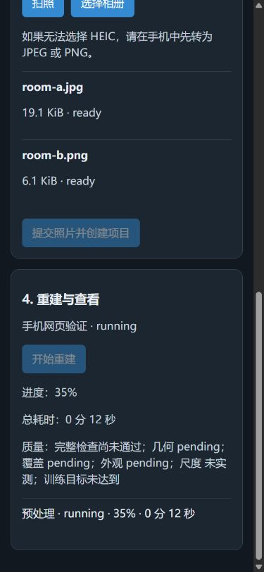

# 通用手机照片重建验证

日期：2026-11-03。环境：Windows。新增入口为手机网关的 `/mobile/`。iPhone 使用 Safari，安卓使用 Chrome；此方式不需要 Mac 或原生 APP。

## 实现范围

- 网页提供配对、项目名称、训练档位、系统拍照、相册多选、逐张上传、重试与移除。
- 上传使用服务器文件 ID、二进制原件和 SHA256 去重。页面显示字节进度。缩略图逐张生成，最大边长为 160 像素。
- 配对和批次信息保存在当前电脑地址的浏览器存储中。刷新后，已完成照片从电脑恢复。未上传照片须重新选择。
- 文件校验包含完整解码、扩展名与内容匹配、尺寸、字节数和像素上限。JPEG、PNG 可用；HEIC/HEIF 仅在实际解码能力检查通过后开放。每个文件仍单独校验。
- 默认限制为 64 MiB/张、500 张/批、4 GiB/批；长边至少 1000 像素，至少两张内容不同的有效照片。未完成或失败项阻止提交。
- 提交创建普通照片项目，并保留 `source-images/` 内的原件和 EXIF。提交不会启动计算。用户点击“开始重建”后，才使用现有七阶段流程。
- 普通照片使用 `inputKind: photos` 和普通 SfM 分支。原有 LiDAR 项目继续使用 `arkit_scan` 和固定标定分支。保留尝试历史、质量状态及累计计时。普通照片尺度显示“未实测”。
- 手机网关默认关闭，默认端口为 8124。设备只能访问自己的批次、项目和查看器资源。写请求使用 Bearer；查看器使用现有 HttpOnly Cookie。

## 自动检查

最终 Node 全套：**159 项通过，0 项失败**。命令：

```powershell
$photoTestFiles = (Get-ChildItem tools/workbench/test_*.mjs).FullName
node --test $photoTestFiles
```

日志：`runs/mobile-photos-final-node.log`。最后一处授权失效提示文案调整后，再次运行手机网页的 8 项定向测试和 JavaScript 语法检查，均通过。

完整 Python 回归：**124 项测试，118 项通过，6 项跳过，0 项失败**。命令：

```powershell
.venv/Scripts/python.exe -X utf8 -B -m unittest discover -s tools/workbench/py -p test_*.py
```

日志和退出码保存在 `runs/mobile-final-verification-35204/`。本次修改后，Python 验证器没有再变更。一次早期未完成的运行曾打印错误标记；该运行未形成可用结论。以上完整运行退出码为 0。

定向检查覆盖以下行为：

- 损坏与截断图片、格式伪装、低分辨率、超大文件、像素限制、EXIF 方向、原始 SHA256 和原件保留。
- HEIC 缺少解码器、伪解码器和真实配置解码器。配置的 ffmpeg 实际解码了 1600×1200 的许可测试样本。截断样本被拒绝。这不保证所有手机 HEIC 变体都可解码。
- 同名文件、重复内容、容量预留、至少两张有效照片、未完成项阻止提交。
- 真实 TCP 中断、当前文件完整重传、服务重启、提交重复调用、哈希损坏、提交前后故障恢复和复制障碍后的重试。
- 无关项目保留、临时文件清理、单个批次恢复失败不阻止其他批次或工作台启动。
- 真实 Python 校验器与真实项目存储的接口集成。原始照片进入新项目；普通照片使用 `SIMPLE_RADIAL` 和普通重建命令。重启后原设备仍可访问；其他设备不能读取批次、读取项目或启动其作业。
- 读取请求体、查询解码能力和图片校验期间撤销设备后，延迟请求不能添加记录或发布文件。现有网关回归覆盖撤销后的延迟启动请求。Cookie 单独不能执行写操作。
- 提交状态为 `committing` 时，网页可以重试创建项目。首次项目查询失败会继续查询，不能重复发送启动请求。401、404、取消、切换批次和终态会停止相应轮询。
- 旧项目、人工辅助、历史模型、累计计时、LiDAR 标定、几何检查、COLMAP 去畸变和触控查看器的现有回归。

`git diff --check` 和手机页面脚本语法检查通过。独立代码审查发现的四项 P2 已修复，并完成限定复审；修复范围内无未处理的 P1/P2。

## 浏览器操作检查

使用桌面内嵌浏览器，视口为 390×844。测试网关仅监听 `127.0.0.1`，使用独立临时项目存储。此检查没有使用正式照片或运行 GPU 训练。

1. 通过配对码连接，创建 standard 批次。
2. 使用页面的文件选择器一次选择两张有效图片和一张损坏图片。网页逐张通过 XHR 上传，显示上传字节及完成数量。
3. 确认两张有效图片保留，损坏图片显示原因，提交按钮禁用。
4. 刷新网页。两张已完成图片恢复；失败图片要求重新选择或移除。
5. 移除损坏项并提交。项目显示 idle，未自动启动任务。
6. 再次刷新，点击“开始重建”。模拟作业只启动一次。页面显示 running、35% 进度、12 秒累计耗时、步骤及“未实测”尺度。模拟作业用于验证状态显示，不证明训练已完成。
7. 撤销设备。下一次轮询后，项目区隐藏，页面返回配对区。随后修正了残留的启动提示，授权失效时统一提示重新配对。

页面没有横向溢出。最后保存状态时，浏览器控制台没有警告或错误。

下图为**模拟作业**的网页截图：



## 待实机验收

- iPhone Safari 和安卓 Chrome：系统相机唤起、相册多选、HEIC 选择与转换、拍照方向、上传进度及页面刷新。
- 手机锁屏、切换应用、Wi-Fi 中断及浏览器回收页面后，重新选择未完成照片并继续上传。
- 使用真实房间照片，从 COLMAP、几何检查、去畸变到 Brush 训练完成；在手机打开实际高斯场景，检查旋转、平移、缩放和移动按钮。
- 检查真实手机的内存、温度、持续上传及漫游效果。大批量边界和实际磁盘耗尽仍需受控环境验收。

Windows 自动测试和桌面窄屏检查不能替代以上实机验收。原生 LiDAR APP 的 Mac 编译、签名和真机验收仍见[原记录](2026-11-02-iphone-lidar.md)。
