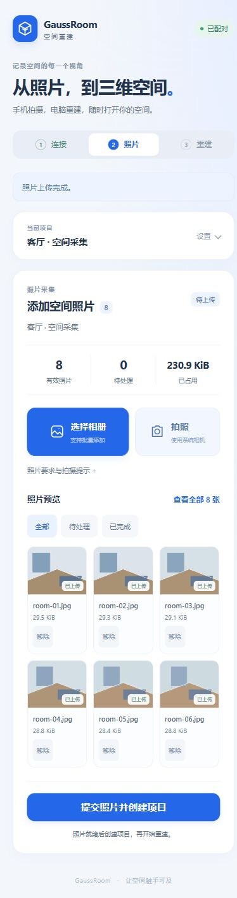
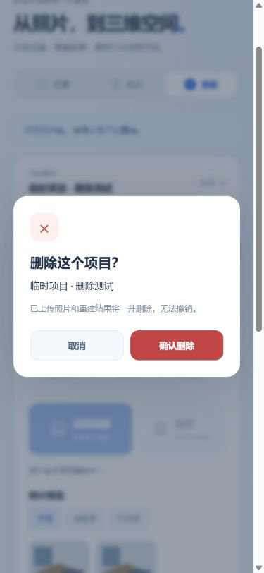

# 手机页面与照片列表验证

日期：2026-11-03。用户选择浅色卡片方案。

## 变化

- 使用浅色背景、白色卡片、蓝色主按钮和中文状态。项目创建或载入后收起设置。
- 照片默认预览最多 6 张，当前上传和待处理项优先。展开后每页 12 张，支持全部、待处理、已完成筛选。
- 照片列表高度最多 420 像素；本地待传队列最多 230 像素。长文件名在卡片中省略，操作名称保留完整文件名。
- 上传和重建显示进度条。失败项保留重新选图、重试和移除入口。提交仍检查完整批次及待传队列，筛选和分页不能绕过校验。

## 检查结果

完整 Node 回归：**164 项通过，0 项失败**，记录于 `runs/mobile-ui-node-final.log`。最终文案调整后，10 项网页定向测试和脚本语法检查再次通过。`git diff --check` 通过。

新增列表回归先失败后通过。覆盖 500 项预览和分页上限、失败优先、筛选、删除后页码收缩、空列表及隐藏失败项阻止提交。

首次完整回归在已有真实照片项目时暴露了初始化重复保存授权的问题。已用一项先失败后通过的回归修复：已有授权不重复写盘。后端接口和格式保持不变。

## 浏览器操作

使用桌面内嵌浏览器及独立本地网关。未修改用户项目，没有运行 GPU 训练。

- 通过系统文件控件批量上传 15 张合成图片和一张损坏图片。15 张通过，损坏项显示原因；默认列表仅显示 6 项，失败项可直接看到。
- 筛选待处理时只显示失败项；移除后可提交。展开 15 张时，第一页 12 项、第二页 3 项，收起后恢复 6 项。
- 刷新后，原批次和已上传照片恢复；缩略图使用文件类型占位，不增加读取原件的接口。
- 500 项列表采用模拟批次元数据，包含 498 项完成、2 项失败。默认 6 项；展开后 12 项，第二页显示 `2 / 42`，列表实测高度 420 像素。此批次只用于列表检查，未提交重建。
- 500 项筛选待处理时显示 2 项。移除一项后只剩 1 项，提交仍禁用。
- 320、390、768 像素视口下，文档宽度等于滚动宽度，无横向溢出。
- 新建批次后，原筛选和页码清除。再次上传 8 张图片，默认预览 6 张。提交后仍需点击“开始重建”；模拟作业显示 35% 及 12 秒，按钮禁用。页面未记录 JavaScript 错误。

以下截图来自合成照片的界面检查：

真实 iPhone Safari、安卓 Chrome 的触控、相机菜单和系统字体效果仍待实机验收。原有配对与重建验证见[手机照片记录](2026-11-03-mobile-photos.md)。

## 项目和批次删除

用户确认需要删除整个项目或上传批次。已在当前项目卡片下增加删除按钮。未提交时显示“删除批次”，提交后显示“删除项目”。页面内确认弹窗展示完整名称和无法撤销提示，默认焦点在取消按钮。

删除只允许当前批次的有效设备令牌。Cookie 无写权限。服务器检查项目关联和运行状态；运行中或停止中的项目不能删除。删除前保存 `deleting` 记录，失败后保留重试入口。清理项目目录时使用已验证的请求 ID。重试可以处理已删除项目记录但仍有残留输出的情况。无关项目及原生 LiDAR 项目不受该入口影响。

新增用例先失败后通过。最终完整 Node 回归：**169 项通过，0 项失败**，日志为 `runs/mobile-delete-node-final.log`。定向删除、网页和接口检查为 29 项通过。独立审查发现的删除残留问题已经修复并复审通过。本次未修改 Python。

浏览器检查使用独立网关和临时项目：取消后仍可上传并创建项目；确认删除后，项目及批次目录均为 0 个，页面返回新建状态；刷新后未重新出现。没有执行真实用户项目删除。运行中保护、设备隔离、失败重试和重启恢复由接口回归覆盖。原生浏览器同步确认框曾阻塞内嵌浏览器，最终使用可检查的 HTML 确认弹窗。

已有工作台进程需要重启一次以加载新增删除接口，再刷新手机页面。真实手机的弹窗和触控仍待实机验收。
